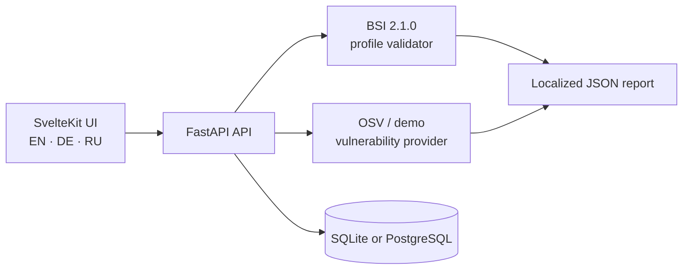

# SupplyGuard

[Deutsch](README.de.md) · [Русский](README.ru.md)

SupplyGuard is an independently developed SBOM security workspace. It validates CycloneDX JSON against the field mapping of **BSI TR-03183-2 v2.1.0**, queries [OSV](https://osv.dev/) for known vulnerabilities, and turns both results into a focused report.

> SupplyGuard implements profile-aligned technical checks. It is not an official BSI certification tool.

## Current profile

| Item | Supported value |
| --- | --- |
| Profile | `BSI TR-03183-2` |
| Profile version | `2.1.0` |
| Mapping basis | `CycloneDX JSON 1.6` |
| Accepted CycloneDX versions | `1.6`, `1.7` |
| Vulnerability provider | OSV live API or deterministic offline demo |

The profile is declared in [`apps/api/app/profile.py`](apps/api/app/profile.py) and returned by the health endpoint, analysis responses, and localized reports. See [`docs/bsi-profile.md`](docs/bsi-profile.md) for the implemented field mapping and limitations.

## Analysis integrity

- CycloneDX 1.6 and 1.7 documents are checked against the bundled official JSON schemas at runtime.
- Component traversal is iterative and bounded by configurable count and depth limits.
- OSV severity uses package-specific `affected[].severity` or top-level CVSS v2/v3/v4 data, with qualitative provider metadata as a fallback.
- Fixed versions are taken only from the `affected` entry matching the scanned package.
- Reports expose scannable, actually scanned, limited, truncated, and partial-data states. OSV pagination is followed and detail failures remain visible instead of being silently discarded.

## Quick start

Requirements: Python 3.12+, [uv](https://docs.astral.sh/uv/), Node.js 22+.

```bash
# Terminal 1 — API
cd apps/api
uv sync --dev
uv run uvicorn app.main:app --reload

# Terminal 2 — web app
cd apps/web
npm ci
npm run dev
```

Open `http://localhost:5173`. API documentation is available at `http://localhost:8000/docs`.

The built-in demo does not need network access. Uploaded SBOMs use live OSV by default; select “Offline demo data” to test without an external request.

Operational limits can be configured with the `SUPPLYGUARD_MAX_COMPONENT_COUNT`, `SUPPLYGUARD_MAX_COMPONENT_DEPTH`, `SUPPLYGUARD_MAX_SCANNED_COMPONENTS`, `SUPPLYGUARD_MAX_OSV_PAGES`, and `SUPPLYGUARD_MAX_OSV_DETAILS` environment variables.

## Docker

```bash
docker compose up --build
```

The web app is exposed on `http://localhost:3000`, the API on `http://localhost:8000`, and PostgreSQL stays inside the Compose network.

## Validation

```bash
cd apps/api
uv run pytest --cov=app --cov-report=term-missing --cov-fail-under=85
uv run ruff check .
uv run ruff format --check .

cd ../web
npm run check
npm run build
```

The API suite includes pinned CycloneDX 1.6 and 1.7 fixtures from the official [`CycloneDX/sbom-utility`](https://github.com/CycloneDX/sbom-utility) test corpus. Their commit, hashes, and license are recorded in [`apps/api/tests/fixtures/upstream/README.md`](apps/api/tests/fixtures/upstream/README.md).

## Architecture



More detail: [`docs/architecture.md`](docs/architecture.md) · [`docs/threat-model.md`](docs/threat-model.md)

## API

- `GET /api/v1/health`
- `POST /api/v1/analyses?provider=osv|demo`
- `POST /api/v1/analyses/demo`
- `GET /api/v1/analyses`
- `GET /api/v1/analyses/{id}`
- `GET /api/v1/analyses/{id}/report?lang=en|de|ru`

## Repository layout

```text
apps/api/       FastAPI service, validator, providers, tests
apps/web/       SvelteKit interface
docs/           Profile mapping, architecture, threat model
samples/        Deterministic CycloneDX 1.6 demo SBOM
.github/        CI workflow
```

## License

MIT
