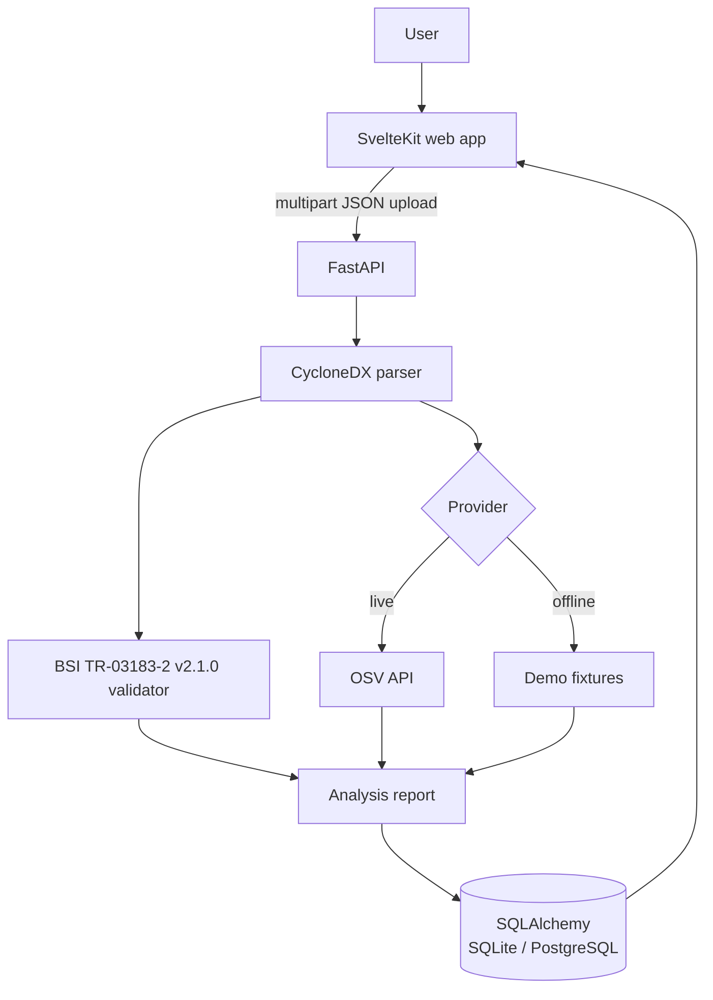

# Architecture

SupplyGuard is a small monorepo with an independently deployable API and web application.

## API

The API is layered by responsibility:

- `parser.py` performs UTF-8 JSON parsing and normalizes components;
- `profile.py` owns the supported profile identifier and version;
- `validator.py` evaluates profile rules without network access;
- `vulnerabilities.py` contains replaceable live and demo providers;
- `service.py` coordinates analysis and score generation;
- `repository.py` isolates persistence;
- `routes.py` defines the HTTP contract;
- `localization.py` renders finding messages in EN/DE/RU.

The normalized report is stored as JSON. This keeps the MVP schema stable while validation rules evolve. Search-heavy production deployments can normalize components and vulnerabilities into separate tables later.

## Web

The SvelteKit client:

- detects EN/DE/RU from the browser and persists the choice locally;
- uploads CycloneDX JSON with a selectable provider;
- presents profile and risk scores separately;
- displays findings, components, vulnerabilities, and recent reports;
- requests a localized report from the API when the language changes.

## Data flow

1. The API enforces the upload-size limit before parsing.
2. The parser rejects invalid encoding, invalid JSON, excessive JSON nesting, and non-object roots.
3. Components are traversed iteratively under count and depth limits, and supported documents are checked against the bundled CycloneDX schema.
4. The deterministic BSI profile validator produces machine-readable finding codes.
5. Components with valid package URLs are selected before the scan limit is applied.
6. OSV pagination, package-specific affected data, CVSS, and detail completeness are normalized into the report.
7. The provider result is combined with—not written into—the SBOM, then persisted and returned.

## Deployment

Local development uses SQLite. Docker Compose uses PostgreSQL and keeps it off the host network. The UI receives the public API base URL through `PUBLIC_API_BASE_URL`.

Production follow-ups should add authentication, per-tenant authorization, retention policies, object storage for original documents if required, and an outbound proxy policy for OSV.
