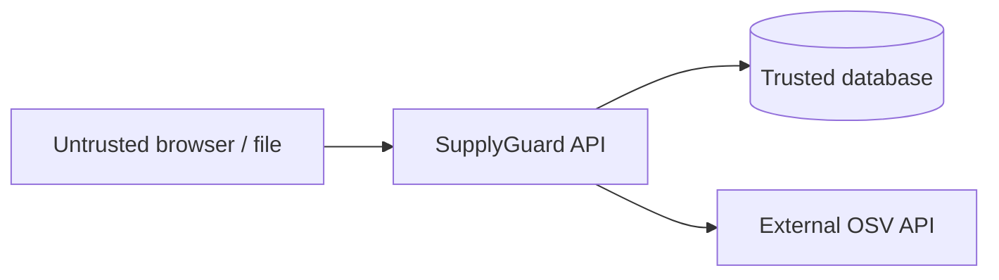

# Threat model

## Scope

SupplyGuard accepts untrusted CycloneDX JSON, parses package identifiers, calls an external vulnerability service, and stores analysis results. The MVP is intended for local or controlled demonstration use, not direct public multi-tenant deployment.

## Assets

- uploaded SBOM contents, which may reveal product composition;
- analysis history and vulnerability results;
- database credentials;
- availability of the API and OSV request quota;
- integrity of profile rules and reports.

## Trust boundaries

## Main threats and current controls

| Threat | Current control | Follow-up |
| --- | --- | --- |
| Oversized upload / memory exhaustion | 5 MiB hard limit before parsing | streaming parser and reverse-proxy limits |
| Malformed or non-UTF-8 input | strict parser, bundled CycloneDX schema validation, controlled errors | reverse-proxy content inspection |
| Deeply nested component structures | iterative traversal with explicit depth and component limits | streaming parser for substantially larger uploads |
| SSRF through SBOM URLs | SupplyGuard never fetches component URLs | keep URL fetching disabled or allowlist destinations |
| OSV abuse / request amplification | component, page, and detail limits; bounded detail batches; timeout; explicit partial-result state | rate limiting, cache, circuit breaker |
| Sensitive SBOM disclosure | database remains internal in Compose | authentication, authorization, encryption, retention |
| Stored script injection | Svelte escapes rendered values; no raw HTML | add CSP and security headers at deployment edge |
| Embedded mutable vulnerability data | explicit `SG007` profile error | separate VEX/CSAF export |
| Dependency compromise | lockfiles, pinned container digests and Actions, Python/npm audits, PR dependency review | signed images and provenance policy |
| Report tampering | immutable analysis ID in MVP | signing/attestation and audit log |

## Privacy

Live OSV queries disclose package URLs to the OSV service. Use the offline demo provider when network disclosure is unacceptable. The MVP stores normalized reports but not the original uploaded byte stream.

## Out of scope for the MVP

- user identity and access control;
- tenant isolation;
- public-internet abuse protection;
- formal BSI certification;
- malware scanning of uploads;
- cryptographic report signing.
